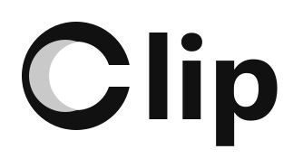
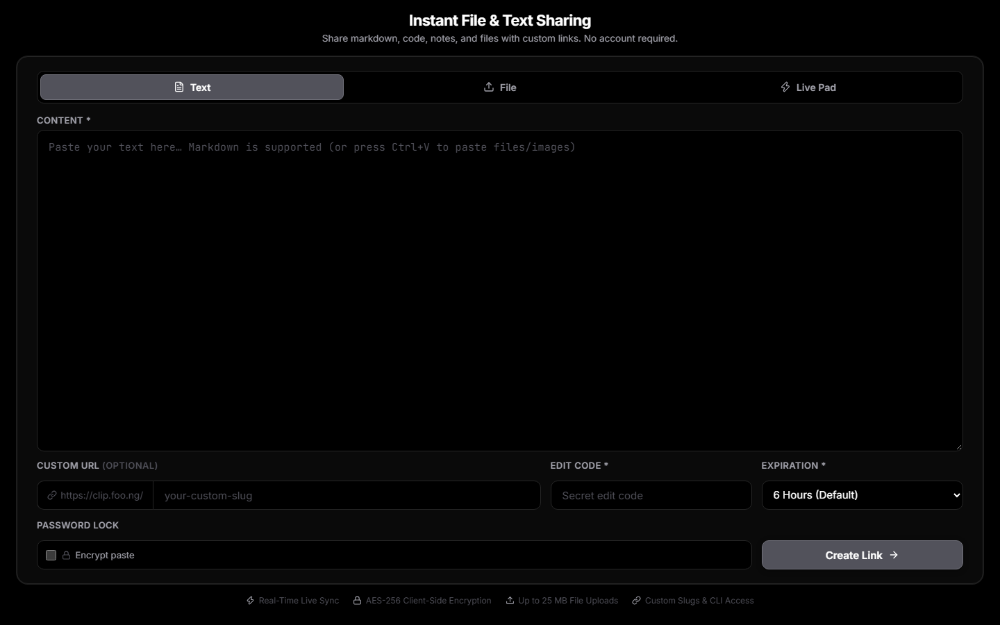

<div align="center">

<p align="center">
  <picture>
    <source media="(prefers-color-scheme: dark)" srcset="docs/logo-dark.svg" />
    
  </picture>
</p>

**Temporary text and file sharing with custom links, optional encryption and a live pad.**

<a href="https://clip.foo.ng"></a>

<br/>



</div>

---

### 💡 Why Clip was built

> *"I created Clip because I was tired of having to log into WhatsApp Web or cloud drives on college library and lab PCs every single time I needed to quickly transfer a code snippet, link, or document to myself or a classmate."*

**Clip** solves this exact problem: a friction-free, lightweight web utility to create temporary, shareable links for text, markdown, and files in seconds - without leaving personal accounts signed in on public computers.

---

### ⭐ Key Features

- 🚀 **Zero Friction, No Sign-up**: Open the site, paste text or drop files, and get a link in seconds. No account, email, or credentials.
- 📦 **Large files, 25 MB to 500 MB (`/b/<id>`)**: one file above the 25 MB share limit goes straight from your browser to a private Backblaze B2 bucket, in parts with automatic retry, and is deleted after the time you choose (1 hour, 6 hours or 1 day). The sender gets a **Delete now** button, and a cleanup job removes expired files every 10 minutes. See [docs/LARGE_FILES.md](docs/LARGE_FILES.md).
- 📡 **Clip Beam (`/beam`), files of any size, browser to browser**: Send multi-gigabyte files straight from your disk to someone else's over an encrypted WebRTC connection. Nothing is uploaded or stored.
  - **Connect once, keep sending**: the connection stays open, so the sender can keep adding files and the receiver chooses **Accept**, **Decline** or **Accept all** for each. Either side can end the connection at any time.
  - **Send to up to 8 people at once**, each with their own progress, speed, and a live time-left countdown.
  - **Nearby radar**: people on your network who switch on Receive mode appear as avatars with cute names. Tap one or several to connect, no PIN needed (a 6-digit PIN and QR code still work). Receive mode is off by default, and they can Decline or Block.
  - **Hard to break**: heartbeat and ICE restart repair a flaky connection, the screen is kept awake, and if it does drop, **Reconnect** (or the automatic retry) continues from where it stopped, even after a reload in Chrome and Edge. Optional TURN relay for strict networks.
  - **Verified**: SHA-256 is checked on both ends, and a damaged file is caught instead of saved.
- ⚡ **Real-Time Live Pad (`/live/:slug`)**: Collaborative notepad and live file room with instant WebSocket sync (Cloudflare Durable Objects). Several people can type together with multi-cursor and random cute names like *Mochi* or *Biscuit*, without overwriting each other.
- 🔒 **Zero-Knowledge Encryption**: Browser-side **PBKDF2 + AES-256-GCM** for pastes, files, edits, and live rooms. The server never sees your password or plaintext.
- 🕒 **Flexible Expiry**: `10 Minutes`, `1 Hour`, `6 Hours` *(Default)*, `1 Day`, `7 Days`, `30 Days`, or `Permanent` for text (attached files auto-purge after 48h).
- 💻 **Terminal / CLI**: Fetch pastes and files from Linux, macOS, or Windows with simple `curl` commands, plus a 1-command ZIP download.
- ⚡ **Edge-Powered**: Cloudflare Workers + KV + Durable Objects + Pages for fast global responses.

### ➕ More Features

- 🖱️ **Multi-Cursor Editing**: Opt in to see everyone's caret in a Live Pad (operational transform, tested with randomized multi-client simulations). Off by default.
- 🎬 **Universal Media & Document Viewer**: Full-screen theater viewer for both LivePad and URL pastes. Cinematic video player, high-res image lightbox with 25%-500% zoom and pan, line-numbered syntax-highlighted code with search and copy, and embedded PDF / audio playback.
- 🗜️ **Client-Side ZIP Archive Inspector**: Click any attached `.zip` to explore its folders and files, search inside it, and extract single files without downloading the whole archive.
- 📦 **1-Command ZIP Download**: Retrieve text (`<slug>.txt`) and all attached files as one ZIP, decrypted on the fly when encrypted.
- 📱 **Phone Pair via QR Code**: Connect your phone to a Live Pad or a Beam in one second by scanning a QR code.
- 📋 **Clipboard & Drag-and-Drop**: Paste screenshots straight from your clipboard (<kbd>Ctrl+V</kbd> / <kbd>Cmd+V</kbd>) or drag and drop files up to 25 MB. One file up to 500 MB can be shared as a **large file** (stored in a private bucket, deleted after 1 hour, 6 hours or 1 day, with a delete-now button for the sender); use Beam for anything bigger.
- 🔑 **Secret Edit Code**: Protect a link with a custom edit password to modify content, add or remove files, or delete early.
- 🔗 **Custom & Retained Slugs**: Pick your own readable slug (`clip.foo.ng/my-notes`) or convert a live room into a permanent clip with the same slug.
- 📁 **Rich Markdown & KaTeX Math**: GitHub Flavored Markdown, task lists, tables, and KaTeX typesetting (LaTeX, matrices, piecewise functions, integrals).
- 🔤 **Developer Typography & Code Blocks**: Syntax highlighting for 40+ languages with JetBrains Mono / Fira Code and 1-click Copy buttons.
- 🛡️ **Admin Live Pad & Expiration Monitor**: Admin section to track active Live Pad rooms, 24-hour rolling expiry countdowns, connected peers, and to terminate rooms.
- 🖥️ **Zero-Scroll Viewport Layout**: The desktop workspace fits 100% of the viewport height and collapses into mobile tabs on narrow screens.
- 🎨 **Pure Monochrome Look**: Solid black (`#000000`) and pure white with Lucide icons.
- 🌐 **SEO & Rich Snippets**: Schema.org `WebApplication` and `FAQPage` snippets, OpenGraph / Twitter cards, `robots.txt`, and `sitemap.xml`.

---

### 📦 Sharing a large file (over 25 MB)

1. On the home page open the **File** tab and drop **one** file between 25 MB and 500 MB. (Several files, or a file over 500 MB, are refused with a clear message; use Beam for those.)
2. Pick how long to keep it: **1 Hour**, **6 Hours** or **1 Day**. Password lock and custom links are not available for large files.
3. Tap **Create Link**. The file uploads straight to storage with a progress bar and lands on `/b/<id>`.
4. Share that link. Visitors see the name, size and a countdown, and tap **Download**. You see **Delete now** on your own browser.

---

### 📡 Using Clip Beam

Open `/beam` (for example `https://clip.foo.ng/beam`) in Chrome or Edge on both devices.

1. **Send**: on the **Send** tab drop one or more files. You get a radar of people nearby, and a 6-digit PIN with a QR code. You can add more files at any time while people are connected.
2. **Receive, with the radar**: on the **Receive** tab switch on **Show me to nearby senders**. When someone picks you, tap **Connect** (or **Decline** / **Block**). No PIN.
3. **Receive, with a PIN**: on the **Receive** tab type the sender's PIN (or scan the QR code) and tap **Connect**.
4. **Each file**: once connected, every file the sender offers asks for your **Accept** (choose where to save it) or **Decline**. Turn on **Accept all** to pick one folder and save everything there automatically.
5. **End it any time**: the receiver taps **Disconnect**; the sender can disconnect one person or **Stop sharing**.
6. **If the connection drops**: press **Reconnect** (it also retries by itself). It continues from where it stopped, and the sender keeps their page open. After a reload, `/beam` lists **Unfinished transfers** you can continue (Chrome and Edge).

Good to know: files go straight between the two browsers and is never stored on Clip's servers. One sender can send to up to 8 people at once. Chrome and Edge save straight to disk with no size limit; Firefox and Safari keep the file in memory (up to 2 GB) and can only resume while the page stays open. Both devices need a direct connection (same Wi-Fi works best); very strict networks need a TURN relay, which is supported but has to be switched on with a Cloudflare TURN key (see the architecture doc). Full design: [docs/CLIP_BEAM_ARCHITECTURE.md](docs/CLIP_BEAM_ARCHITECTURE.md).

---

### 💻 Terminal / CLI Usage

Download your pastes & files directly from any terminal without opening a browser:

#### 1. Download Everything as ZIP (Text + All Files)
```bash
# Linux / macOS
curl -fLO https://clip.foo.ng/z/<slug>.zip

# Windows (PowerShell / CMD)
curl.exe -fLO https://clip.foo.ng/z/<slug>.zip
```

#### 2. Print Raw Text to Terminal
```bash
# Linux / macOS
curl -sL https://clip.foo.ng/r/<slug>

# Windows (PowerShell / CMD)
curl.exe -sL https://clip.foo.ng/r/<slug>
```

#### 3. Download File Attachment
```bash
# Linux / macOS
curl -fLJO https://clip.foo.ng/f/<slug>

# Windows (PowerShell / CMD)
curl.exe -fLJO https://clip.foo.ng/f/<slug>
```

---

### 🛠️ Tech Stack

| Component | Technology |
| :--- | :--- |
| **Frontend** | React 18, TypeScript, Vite, Vanilla CSS (Pure Monochrome), Lucide Icons, Marked, KaTeX, Prism.js, fflate |
| **Backend API** | Cloudflare Workers, Hono.js, Cloudflare KV Storage, fflate (zip generation) |
| **Real-Time Engine** | Cloudflare Durable Objects (SQLite-backed): `ClipRoom` for Live Pad sync, `BeamRoom` for Beam connection setup, `BeamLobby` for the nearby radar |
| **Large files** | Backblaze B2 (private S3-compatible bucket), SigV4 signed direct uploads and downloads, a scheduled worker for expiry |
| **Clip Beam** | WebRTC data channels (peer to peer), File System Access API, IndexedDB (resume), `hash-wasm` (SHA-256) |
| **Hosting & CDN** | Cloudflare Pages + Custom Domain (`clip.foo.ng`) |
| **Search & SEO** | Schema.org JSON-LD (WebApplication & FAQPage), XML Sitemap, Robots.txt, OpenGraph |

---

### 🚀 Local Development

Run both the frontend and backend locally with just two commands from the root workspace directory:

```bash
# 1. Install all dependencies (installs root, frontend, and worker dependencies automatically)
npm install

# 2. Run both Vite frontend and Wrangler worker concurrently
npm run dev
```

For a detailed breakdown of the codebase architecture, environment setup, and contribution guidelines, please refer to the [CONTRIBUTING.md](CONTRIBUTING.md) guide.  
For how Clip Beam works (rooms, radar, resume, tests), see [docs/CLIP_BEAM_ARCHITECTURE.md](docs/CLIP_BEAM_ARCHITECTURE.md). How large files work and are set up: [docs/LARGE_FILES.md](docs/LARGE_FILES.md) (the original plan, which used R2, is in [docs/HYBRID_LARGE_FILE_TRANSFER_SPEC.md](docs/HYBRID_LARGE_FILE_TRANSFER_SPEC.md)).  
For a full history of bug fixes and architectural updates, see [docs/CHANGELOG.md](docs/CHANGELOG.md).

---

### 🧪 Automated Testing

Clip includes automated tests for crypto, uploads, expiration, CLI generation, live sync, and Clip Beam (room and radar logic, speed and time-left maths, a real worker, and real Chrome pages sending files to each other, including dropped connections):

```bash
npm test                 # unit tests, nothing needs to be running
npm run test:beam        # all Clip Beam tests (needs the worker and site running locally)
npm run test:big         # large-file tests, against the real B2 bucket (needs B2 keys in worker/.dev.vars)
npm run test:all         # everything
```

See [docs/TESTING.md](docs/TESTING.md) for what each suite covers and how to run the ones that need the worker and site.

---

### 📡 1-Command Deployment

Deploy both the Cloudflare Worker API and Frontend Pages build in a single step from the root directory:

```bash
npm run deploy
```

* Deploy worker only: `npm run deploy:worker`
* Deploy frontend only: `npm run deploy:frontend`
* The first deploy that includes Clip Beam also creates the `BeamRoom` and `BeamLobby` Durable Objects (migrations `v2` and `v3`); nothing else needs configuring.
* Large files need two secrets on the worker, set once: `npx wrangler secret put B2_KEY_ID` and `npx wrangler secret put B2_APP_KEY` (a key limited to the one bucket; see [docs/LARGE_FILES.md](docs/LARGE_FILES.md)). The deploy also schedules the 10-minute cleanup job.
* Run it from the `main` branch: Cloudflare Pages only treats `main` as production, and any other branch is published as a preview.

---

### 📄 License

Distributed under the MIT License. See `LICENSE` for more information.

