# User Analytics & Admin Dashboard Design

**Date:** 2026-11-01  
**Status:** Ready for Review  
**Topic:** Privacy-First Site Analytics with Laptop & IP Exclusion

---

## 1. Intent & The Why

Clip needs a lightweight, self-contained way to understand how many people are using the site, which pages they visit, where they come from, and what devices they use. 

Crucially, the site owner’s own testing, browsing, and admin monitoring must **not** inflate these statistics. The analytics system must provide accurate real-world visitor metrics directly inside the password-protected `/admin` dashboard while ensuring complete user privacy (no cross-site tracking, no cookies, no invasive fingerprinting).

---

## 2. Goals, Non-Goals & Anti-Goals

### Goals
- **Self-Hosted & Zero External Dependency:** Runs entirely on Clip's Cloudflare Worker and frontend without external services (no Google Analytics, Umami, or Plausible subscriptions).
- **Accurate Real-World Traffic:** Tracks total page views, unique daily/weekly/monthly visitors, top paths, referrers, devices, and countries.
- **Laptop & IP Exclusion:** 
  1. Instant client-side toggle ("Exclude this browser/laptop") stored in `localStorage` (`clip_analytics_opt_out = "1"`) so the owner's laptop never fires tracking beacons, even if their IP changes.
  2. Server-side IP blacklist stored in KV (`analytics:excluded_ips`) to block requests from known owner networks.
  3. Automatic exclusion for requests containing valid `ADMIN_SECRET` authorization or visiting `/admin`.
- **Integrated Admin View:** A new "Analytics" tab in `AdminPage.tsx` displaying key metrics (Today, 7 days, 30 days), breakdown tables/bars, and exclusion settings.
- **Privacy by Design:** IPs are never stored in plain text. Unique visitors are counted using a rotating salted hash (`HMAC(IP, monthlySalt, YYYY-MM)`). Route slugs (e.g. secret paste IDs) are sanitized so private paste URLs are never logged in analytics.

### Non-Goals
- Multi-touch ad attribution or marketing funnels.
- Session recording, mouse replay, or heatmaps.
- Storing personally identifiable information (PII).

### Anti-Goals
- **No GDPR Cookie Banners:** The system must not store tracking cookies on visitor devices or track users across external sites.
- **No Performance Degradation:** The client beacon must be fire-and-forget (< 1 KB) using `navigator.sendBeacon` or background fetch so page loads and navigation remain instant.

---

## 3. Constraints & Infrastructure

- **Cloudflare Edge Environment:** The Worker runs on Cloudflare with Hono, KV (`PASTE_KV`), and Durable Objects (`ClipRoom`, `BeamRoom`, `BigUploadStore`).
- **Storage Selection:** Cloudflare Durable Object with SQLite (`AnalyticsStore`) provides atomic concurrent writes, structured SQL grouping (`GROUP BY path`, `COUNT(DISTINCT visitor_hash)`), and instant query latency without KV rate-limit bottlenecks.
- **Admin Authentication:** Gated by `ADMIN_SECRET` already configured in Worker and saved in `localStorage.getItem('clip_admin_secret')`.

---

## 4. Approaches Considered

### Approach 1: Edge-Native Cloudflare Analytics via SQLite Durable Object (Selected)
- **Description:** A dedicated beacon endpoint (`/api/analytics/event`) receives page view events. The server verifies the client exclusion flag and IP blacklist. Valid events are recorded into an `AnalyticsStore` Durable Object backed by SQLite. The Admin panel queries `/api/admin/analytics` to display totals, trends, and manage excluded IPs.
- **Pros:** 100% self-contained, no external accounts, zero monthly fees, integrated directly into the existing `/admin` UI, and supports both dynamic browser exclusion and static IP blocking.
- **Cons:** Requires implementing the storage aggregation and dashboard UI.

### Approach 2: Cloudflare GraphQL Analytics Proxy
- **Description:** Cloudflare Web Analytics is enabled at the domain level, and the Worker queries Cloudflare GraphQL API to display traffic inside the Admin panel.
- **Pros:** Cloudflare collects edge traffic automatically.
- **Cons:** Cloudflare's script doesn't allow excluding specific devices or local storage toggles from within Clip's admin panel, and requires generating and maintaining Cloudflare API tokens with analytics read permissions.

### Approach 3: External Privacy Analytics (Umami / Plausible)
- **Description:** Set up an external Umami or Plausible instance and embed the dashboard in an iframe or fetch via API.
- **Pros:** Pre-built charts out of the box.
- **Cons:** Adds third-party dependencies, extra servers or recurring costs, and fragments admin authentication.

---

## 5. System Design & How It Works

```mermaid
flowchart TD
    Browser["Visitor Browser"] -->|1. Route Navigation| Hook["Analytics Beacon Hook"]
    Hook -->|2. Check localStorage opt-out| OptOutCheck{"Laptop Excluded?"}
    OptOutCheck -->|Yes| DropClient["Drop Beacon (Do Not Send)"]
    OptOutCheck -->|No| BeaconReq["POST /api/analytics/event"]
    
    BeaconReq --> Worker["Cloudflare Worker"]
    Worker --> AuthCheck{"Admin or Excluded IP?"}
    AuthCheck -->|Yes| DropServer["Discard (204 No Content)"]
    AuthCheck -->|No| Collect["Parse Country, Referrer, Normalized Path, Device"]
    
    Collect --> Hash["Generate Visitor Hash (Monthly Salt + IP)"]
    Hash --> Storage["AnalyticsStore DO (SQLite)"]
    
    AdminUser["Site Owner in /admin"] -->|View Stats| AdminAPI["GET /api/admin/analytics"]
    AdminAPI --> Storage
    AdminUser -->|Toggle Laptop Exclusion| LocalStorage["Set localStorage flag"]
    AdminUser -->|Add/Remove Excluded IP| KVConfig["Update analytics:excluded_ips in KV"]
```

### 5.1 Laptop & Owner Exclusion Mechanism
1. **Client-Side Toggle (Primary):** In the Admin panel, a setting switch *"Exclude this device from analytics"* sets `clip_analytics_opt_out = "1"` in `localStorage`. The frontend analytics hook checks this before dispatching any network request. If set, no beacon is ever transmitted.
2. **Server-Side IP Filter:** In the Admin panel, the owner's current detected IP (`CF-Connecting-IP`) is displayed with a one-click *"Exclude my current IP"* button. The list of excluded IPs is persisted in KV (`analytics:excluded_ips`). Any beacon matching an excluded IP is immediately dropped with a 204 status without being counted.
3. **Admin Token Exclusion:** Any request carrying the `ADMIN_SECRET` Bearer token or visiting `/admin` paths is strictly ignored.

### 5.2 Data Collected & Privacy Normalization
- **Path Sanitization:** Specific pages like `/`, `/about`, `/beam`, `/live` are tracked as-is. Dynamic entry links are sanitized to generic patterns like `/:slug`, `/live/:slug`, or `/b/:slug` so that private paste URLs or secret tokens are never stored in analytics.
- **Country & City:** From Cloudflare headers (`cf.country`, `cf.city`).
- **Device:** Desktop, Mobile, or Tablet (detected from User-Agent).
- **Referrer:** Top external domains (e.g., `google.com`, `x.com`, `direct`).
- **Unique Visitors:** Counted by hashing `SHA256(IP + Salt + YYYY-MM)`. Rotating the salt monthly allows deduplicated unique counts over 7-day and 30-day windows while preventing long-term profiling. Raw IPs are never written to the database.

### 5.3 Storage Architecture
- A singleton Durable Object (`AnalyticsStore`) backed by Cloudflare SQLite with two tables:
  1. `views`: Raw events for the rolling 30 days (`id`, `date`, `timestamp`, `path`, `referrer`, `country`, `device`, `visitor_hash`).
  2. `daily_rollups`: Compact permanent history (`date` PRIMARY KEY, `total_views`, `unique_visitors`, `paths_json`, `countries_json`, `devices_json`, `referrers_json`).
- High-frequency writes execute against SQLite inside the DO with zero lock contention. Daily rollups ensure historical statistics remain accessible indefinitely even after raw events are purged.

### 5.4 Admin UI Features
Inside `AdminPage.tsx`, a third tab **"Analytics"** will feature:
1. **Header Cards:**
   - Total Page Views (Today, Last 7 Days, Last 30 Days)
   - Unique Visitors (Today, Last 7 Days, Last 30 Days)
2. **Breakdown Tables & Visual Bars:**
   - Top Pages / Features (`/`, `/about`, `/beam`, `/:slug`, etc.)
   - Top Traffic Referrers
   - Visitor Countries (with country codes/flags)
   - Device Breakdown (% Desktop vs % Mobile)
3. **Exclusion Controls:**
   - Status badge: *"This Laptop is Excluded"* (with instant toggle).
   - Excluded IPs list: Shows detected IP right now with one-click Add/Remove.

---

## 6. Verification Plan

1. **Beacon Test:** Navigating the site in an incognito window triggers `/api/analytics/event` and increments the view counter in `/admin`.
2. **Laptop Exclusion Test:** Enabling the "Exclude this device" toggle in `/admin` stops all beacons from being transmitted from the browser.
3. **IP Filter Test:** Adding an IP to the excluded IP list drops incoming beacons from that IP on the server with 204 No Content and no counter increment.
4. **Admin View Test:** The Analytics tab in `/admin` renders all stat cards, top pages, referrers, countries, and devices accurately without UI errors.
